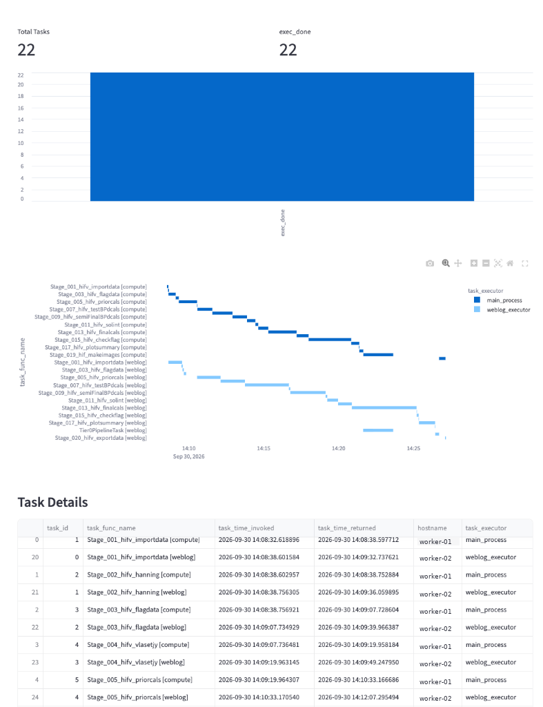

# User Guide

This guide describes how to configure and run the [CASA](https://casa.nrao.edu/) pipeline using PAC-MAN.

## 1. Environment Setup

PAC-MAN uses [Pixi](https://pixi.sh/) to manage CASA and pipeline dependencies.

Install dependencies and enter the environment shell:
```bash
pixi install
pixi shell
```

## 2. Executing a Pipeline Workflow

PAC-MAN provides `pac_man_reduce()` as a replacement for standard `recipereducer`. It accepts standard pipeline procedure definitions and MeasurementSets:

```python
from pac_man.runner import pac_man_reduce

context = pac_man_reduce(
    vis=['uid___A002_X123456_X789.ms'],
    procedure='procedure_hifv.xml',
    backend='subprocess'
)
```

### Supported Execution Backends

Specify the execution backend with the `backend` argument:

- `subprocess`: Spawns local worker processes via [Parsl HighThroughputExecutor](https://parsl.readthedocs.io/en/stable/stubs/parsl.executors.HighThroughputExecutor.html) (default for workstation runs).
- `htcondor`: Submits heavy compute jobs to [HTCondor](https://htcondor.org/) worker nodes with dedicated memory allocations (32 GB for compute, 8 GB for rendering).
- `slurm`: Submits jobs to a configured [Slurm](https://slurm.schedmd.com/) partition.
- `threads`: Runs tasks via `ThreadPoolExecutor`. **Not recommended for production runs** due to thread-safety limitations in CASA C++ libraries.

Example using HTCondor:
```python
context = pac_man_reduce(
    vis=['uid___A002_X123456_X789.ms'],
    procedure='procedure_hifv.xml',
    backend='htcondor',
    max_tier0_workers=50,
    max_weblog_workers=2
)
```

### Logging

Python console timestamps omit fractional seconds and retain padding so that
`[INFO]` or `[DEBUG]` begins in the same column as CASA's `INFO1` priority.
CASA's own log format and timestamps remain unchanged.

Set `loglevel = "debug"` for detailed pipeline output and
`parsl_loglevel = "info"` to keep Parsl console output at INFO and above.
Parsl defaults to INFO on the console independently of the pipeline level.
Its diagnostic files in `runinfo/` retain their existing detailed logging.
Both settings can be overridden from the CLI:

```bash
pac-man --profile default --loglevel debug --parsl-loglevel info
```

### Scheduler Routing

Scheduler routing can be configured per profile. Slurm supports
`slurm_partition`, `slurm_account`, `slurm_qos`, and `slurm_constraint`.
When `slurm_partition` is omitted, PAC-MAN inherits `SLURM_JOB_PARTITION` if
the main process is itself a Slurm job; otherwise Slurm applies the user's or
site's default partition.

Slurm starts with zero allocations and requests worker blocks as tasks arrive.
Each nonexclusive, single-node block runs one worker with one CPU.
`max_tier0_workers` limits compute blocks (default 10 when omitted or zero),
and `max_weblog_workers` limits weblog blocks (default 2).
`slurm_tier0_memory_gb` (default 32 GB) and `slurm_weblog_memory_gb`
(default 8 GB) now specify memory **per worker**, rather than per pool.
For example, eight compute workers at 12 GB each can reserve up to 96 GB,
but no compute resources are reserved before work arrives.
Workers are reused across tasks. Parsl's `htex_auto_scale` strategy releases
blocks idle for about 120 seconds, with scheduling and polling latency.
Blocks can share nodes when the partition permits it and sufficient CPUs
and memory are available. Resource changes apply to newly submitted
allocations; restart the runner to use the new configuration.

HTCondor has no partition concept. Use `condor_requirements` to constrain
matching slots and `condor_project` or `condor_accounting_group` for routing
and accounting. When the main process is an HTCondor job, omitted project and
accounting-group values are inherited from its job ad. With no overrides,
`condor_submit` continues to use the submit host's configured pool.

```toml
[profiles.cluster]
inherits = "default"
backend = "slurm"
slurm_partition = "compute"
slurm_account = "project-name"
max_tier0_workers = 10
max_weblog_workers = 2
slurm_tier0_memory_gb = 32
slurm_weblog_memory_gb = 8

[profiles.grid]
inherits = "default"
backend = "htcondor"
condor_project = "demo"
condor_requirements = "TARGET.HasFeature == true"
condor_accounting_group = "group.demo"
```

### Scheduler Job Names

Slurm job names and HTCondor `JobBatchName` attributes use the selected
profile, worker role, and Parsl block number. For example, profile `demo`
produces `demo-t0-04` for compute block 4 and `demo-wl-01` for weblog block 1.
Block numbers start at zero and use at least two digits. Names are capped at
32 characters by shortening the profile prefix; characters other than letters,
digits, underscores, and hyphens are replaced with hyphens.

The CLI uses the selected profile name automatically. Python callers can pass
`profile_name="demo"` to `pac_man_reduce`, `pac_man_executeppr`,
`pac_man_executevlappr`, or `initialize_parsl`; the default is `pacman`.

Display the names with:

```bash
# Slurm
squeue -u "$USER" -o "%.18i %.32j %.8T"

# HTCondor: batch view or explicit per-job columns
condor_q -batch
condor_q -af ClusterId ProcId JobBatchName JobStatus
```

Workers can serve several stages, so stage names appear in the dashboard's
task labels. Parsl executor labels and timestamped script/log filenames retain
their original identifiers. Display names can repeat across runs; use scheduler
job IDs to distinguish individual allocations. HTCondor's batch view may group
jobs from separate runs that share a name.

The naming applies to newly submitted jobs after restarting the runner.

### CLI Pipeline Runner

PAC-MAN provides the `pipeline-test` task mapped to `scripts/test_pipeline.py`. To prevent polluting the repository root with runtime logs (`casapy.log`), plots, and checkpoints, pipeline runs are automatically isolated in `working/` when invoked from the repository root.

#### 1. Inside the Repository

Run directly from the repository root. The runner detects invocation from the workspace root via `INIT_CWD` and automatically routes execution into the gitignored `working/` directory:

```bash
# Run VLA reduction (default: subprocess backend, procedure_hifv.xml)
pixi run pipeline-test --telescope vla

# Run ALMA reduction with HTCondor backend
pixi run pipeline-test --telescope alma --backend htcondor

# Run ALMA 3-EB parallel import test (2019.1.00847.S / PIPE-2013)
pixi run pipeline-test --telescope alma-3eb

# Dry-run validation (checks dataset discovery and configuration without executing)
pixi run pipeline-test --telescope alma-3eb --dry-run
```

All CASA logs, checkpoints, and intermediate products are generated locally in `working/`, keeping the repository root clean.

#### 2. Custom Directory or Outside the Repository

To specify an explicit working directory, pass `--workdir` (or `-w`):

```bash
pixi run pipeline-test --telescope vla --workdir /path/to/scratch
```

When running from an external directory outside the repository (such as `/tmp` or a scratch filesystem), export `PACMAN_ROOT` and pass `--manifest-path` (or `-m`):

```bash
export PACMAN_ROOT=/path/to/pac-man

# Run from any external directory
pixi run --manifest-path "$PACMAN_ROOT" pipeline-test --telescope vla
```

Supported CLI options:

- `-t, --telescope`: Target workflow (`vla`, `alma`, or multi-EB import test `alma-3eb` / alias `3eb`). Default: `vla`. Can also be passed positionally.
- `-b, --backend`: Parsl execution backend (`subprocess`, `htcondor`, `slurm`, `threads`). Default: `subprocess`.
- `-w, --workdir`: Target working directory for execution. Defaults to `working/` if invoked from the repository root.
- `--vis`: One or more custom MeasurementSet or ASDM paths to reduce (supports multiple inputs for parallel import testing).
- `-p, --procedure`: Pipeline recipe XML filename or path.
- `--exitstage`: Stage number at which to stop execution.
- `--dry-run`: Resolves dataset(s) and validates parameters without executing reduction.
- `--loglevel`: Logging verbosity (`debug`, `info`, `warning`, `error`). Default: `info`.

## 3. Real-Time Monitoring

PAC-MAN provides multiple interfaces to track execution, task concurrency, and resource utilization.

### Execution Concurrency Model

PAC-MAN decouples heavy pipeline computations from QA assessment and WebLog rendering. While `main_process` executes pipeline stage heuristics, completed checkpoints trigger asynchronous `weblog_executor` tasks in the background:

```mermaid
gantt
    title Pipeline Stage & Background Weblog Concurrency
    dateFormat X
    axisFormat %M:%S

    section Compute (main_process)
    hifv_importdata [compute] :done, c1, 0, 10
    hifv_hanning [compute]    :done, c2, after c1, 2
    hifv_flagdata [compute]   :done, c3, after c2, 35
    hifv_vlasetjy [compute]   :done, c4, after c3, 15
    hifv_priorcals [compute]  :done, c5, after c4, 75
    hifv_syspower [compute]   :done, c6, after c5, 5
    hifv_testBPdcals [compute]:active, c7, after c6, 4

    section Background Weblog (weblog_executor)
    hifv_importdata [weblog]  :done, w1, 10, 60
    hifv_hanning [weblog]     :done, w2, after w1, 6
    hifv_flagdata [weblog]    :done, w3, after w2, 8
    hifv_vlasetjy [weblog]    :done, w4, after w3, 14
    hifv_priorcals [weblog]   :active, w5, 160, 168
```



---

### Streamlit Dashboard
Launch the [Streamlit](https://streamlit.io/) monitoring dashboard to track stage progress, execution durations, and background task states:

```bash
pixi run dashboard
```
The dashboard runs at `http://localhost:8502` and automatically discovers telemetry from `working/runinfo/monitoring.db`.



#### Interactive Timeline Widget

<details>
<summary><b>Interactive Telemetry Timeline</b> (click to expand &mdash; hover over tasks to inspect duration, worker assignment, and status, or drag to zoom)</summary>

<iframe src="assets/dashboard_timeline.html" width="100%" height="430px" frameborder="0" style="border: 1px solid #e0e0e0; border-radius: 6px; margin-top: 10px;"></iframe>

</details>

To refresh or regenerate the static timeline asset from a completed pipeline run:
```bash
pixi run export-dashboard
```

### Parsl Visualizer
Launch Parsl's built-in DAG [visualizer](https://parsl.readthedocs.io/en/stable/userguide/monitoring.html):

```bash
pixi run visualize
```
The visualizer runs at `http://localhost:8080`, displaying active worker nodes, task status graphs, and runtime resource metrics.

### Incremental Weblog
The pipeline weblog is rendered asynchronously to `html/index.html`. As each background stage finishes, refreshing the browser page reflects newly rendered stage details and QA scoring.

### CASA Log Output
The main console and `casapy.log` continue to record pipeline execution output according to standard [CASAdocs logging](https://casadocs.readthedocs.io/):
```bash
tail -f casapy.log
```

## References

For formal citations, DOIs, and developer manuals, see the [References & Citations](references.md) section.

