# User Guide

This guide describes how to configure and run the [CASA](https://casa.nrao.edu/) pipeline using PAC-MAN.

## 1. Environment Setup

PAC-MAN uses [Pixi](https://pixi.sh/) to manage CASA and pipeline dependencies.

Install dependencies and enter the environment shell:
```bash
pixi install
pixi shell
```

## 2. Executing a Pipeline Workflow

PAC-MAN provides `pac_man_reduce()` as a replacement for standard `recipereducer`. It accepts standard pipeline procedure definitions and MeasurementSets:

```python
from pac_man.runner import pac_man_reduce

context = pac_man_reduce(
    vis=['uid___A002_X123456_X789.ms'],
    procedure='procedure_hifv.xml',
    backend='subprocess'
)
```

### Supported Execution Backends

Specify the execution backend with the `backend` argument:

- `subprocess`: Spawns local worker processes via [Parsl HighThroughputExecutor](https://parsl.readthedocs.io/en/stable/stubs/parsl.executors.HighThroughputExecutor.html) (default for workstation runs).
- `htcondor`: Submits heavy compute jobs to [HTCondor](https://htcondor.org/) worker nodes with dedicated memory allocations (32 GB for compute, 8 GB for rendering).
- `slurm`: Submits jobs to a configured [Slurm](https://slurm.schedmd.com/) partition.
- `threads`: Runs tasks via `ThreadPoolExecutor`. **Not recommended for production runs** due to thread-safety limitations in CASA C++ libraries.

Example using HTCondor:
```python
context = pac_man_reduce(
    vis=['uid___A002_X123456_X789.ms'],
    procedure='procedure_hifv.xml',
    backend='htcondor',
    max_tier0_workers=50,
    max_weblog_workers=2
)
```

### Project Directories and Symlinks

`workdir` names the project parent containing `working/` and `rawdata/`, for
both PPR and recipe profiles. The `--workdir` CLI option has the same meaning.
PAC-MAN creates and enters `<workdir>/working` for execution; logs, state and
`runinfo/` remain inside that directory. Without an explicit root, the CLI uses
the invocation directory as the project parent.

```toml
[profiles.demo_ppr]
mode = "ppr"
telescope = "alma"
ppr = "/shared/project/working/PPR.xml"
workdir = "/shared/project"
# rawdata = "/other/input-root" # Optional override of automatic discovery
```

The layout is:

```text
project/                  # workdir
  working/                # execution directory; may be a symlink
  rawdata/                # PPR inputs; may be a symlink
```

For compatibility, a `workdir` or `--workdir` path ending in `working` is treated
as an execution-directory path, with its parent as the project root. It does
not create `working/working`. Classification happens before resolving symlinks,
so a convenience `project/working` symlink still finds `project/rawdata`.

ALMA and VLA PPR profiles use an existing `<workdir>/rawdata` by default.
An explicit `rawdata` profile setting takes precedence and disables the working-directory
dataset fallback. Relative `rawdata` profile values are anchored to the config
file; environment variables and `~` are expanded. Python callers can pass
`rawdata_dir="/shared/project/rawdata"` to either PPR runner; relative API values
use the current directory. Direct Python runners continue to execute in their
current directory. Internal `working_dir` parameters still identify the actual
execution directory, rather than the project root.

Without an explicit input root, PPR runners honor a nonempty `SCIPIPE_ROOTDIR`
and the PPR `<RelativePath>` for production directory routing. An empty or unset
variable uses the local directory fallback. A supplied `rawdata_dir`, including
one selected from a profile's project root, takes precedence over that variable.

The `pipeline-test` entry point anchors existing relative `--vis` and
`--procedure` inputs to the invocation directory before entering `working/`.
Unresolved CASA dataset and recipe aliases remain available to CASA's resolver.

The PPR parser's `Relative path:` message reports the XML's `<RelativePath>`.
`PPR input raw-data directory:` identifies the directory selected by PAC-MAN.

### Logging

Python console timestamps omit fractional seconds and retain padding so that
`[INFO]` or `[DEBUG]` begins in the same column as CASA's `INFO1` priority.
CASA's own log format and timestamps remain unchanged.

Set `loglevel = "debug"` for detailed pipeline output and
`parsl_loglevel = "info"` to keep Parsl console output at INFO and above.
Parsl defaults to INFO on the console independently of the pipeline level.
Its diagnostic files in `runinfo/` retain their existing detailed logging.
Both settings can be overridden from the CLI:

```bash
pac-man --profile default --loglevel debug --parsl-loglevel info
```

### Scheduler Routing

Scheduler routing can be configured per profile. Slurm supports
`slurm_partition`, `slurm_account`, `slurm_qos`, and `slurm_constraint`.
When `slurm_partition` is omitted, PAC-MAN inherits `SLURM_JOB_PARTITION` if
the main process is itself a Slurm job; otherwise Slurm applies the user's or
site's default partition.

Slurm starts with zero allocations and requests worker blocks as tasks arrive.
Each nonexclusive, single-node block runs one worker with one CPU.
`max_tier0_workers` limits compute blocks (default 10 when omitted or zero),
and `max_weblog_workers` limits weblog blocks (default 2).
`slurm_tier0_memory_gb` (default 32 GB) and `slurm_weblog_memory_gb`
(default 8 GB) now specify memory **per worker**, rather than per pool.
For example, eight compute workers at 12 GB each can reserve up to 96 GB,
but no compute resources are reserved before work arrives.
Workers are reused across tasks. Parsl's `htex_auto_scale` strategy releases
blocks idle for about 120 seconds, with scheduling and polling latency.
Blocks can share nodes when the partition permits it and sufficient CPUs
and memory are available. Resource changes apply to newly submitted
allocations; restart the runner to use the new configuration.

HTCondor has no partition concept. Use `condor_requirements` to constrain
matching slots and `condor_project` or `condor_accounting_group` for routing
and accounting. When the main process is an HTCondor job, omitted project and
accounting-group values are inherited from its job ad. With no overrides,
`condor_submit` continues to use the submit host's configured pool.

```toml
[profiles.cluster]
inherits = "default"
backend = "slurm"
slurm_partition = "compute"
slurm_account = "project-name"
max_tier0_workers = 10
max_weblog_workers = 2
slurm_tier0_memory_gb = 32
slurm_weblog_memory_gb = 8

[profiles.grid]
inherits = "default"
backend = "htcondor"
condor_project = "demo"
condor_requirements = "TARGET.HasFeature == true"
condor_accounting_group = "group.demo"
```

### Remote HTCondor Schedd

When the PAC-MAN main process runs away from the submission host (for example,
inside a Slurm allocation or an HTCondor execute job), select the schedd that
will own its worker jobs:

```toml
[profiles.demo]
inherits = "default"
backend = "htcondor"
condor_schedd = "schedd.example.org"
condor_pool = "collector.example.org:9618"
```

`condor_schedd` is the schedd's advertised `Name`, which may differ from its
hostname. `condor_pool` selects the collector used to locate it; omit this to
use the client's configured collector. A pool override requires an explicit
schedd so all worker commands address the same queue. With neither option,
Parsl's existing default submission behavior is unchanged. Both worker pools
use these settings. Public Python runners and `initialize_parsl` accept the
same `condor_schedd` and `condor_pool` keywords.

PAC-MAN adds only `-name` and the optional `-pool` to `condor_submit`,
`condor_q`, and both worker-removal commands. It does not add `-spool` or
`-remote`, and does not run `condor_transfer_data` during polling or cleanup.
This follows the pool's existing shared-filesystem submission behavior:

```bash
condor_submit -name schedd.example.org -pool collector.example.org:9618 worker.submit
```

File-transfer and spooling behavior otherwise follow HTCondor's client/site
configuration and the existing Parsl submit template. Science products remain
in the shared working directory under the existing pipeline execution model.

This routes scheduler commands; it does **not** grant submission permission.
Ask your administrator to provide remote authentication and authorization for
submission, querying, and removal from the node running PAC-MAN.
For example, the site may configure IDTOKENS or another supported remote
authentication method. Keep credentials in HTCondor's normal secure credential
configuration, not profile files. If site policy prohibits submission from
execute nodes, these settings cannot override that restriction.

The main node needs the HTCondor command-line tools and network access to the
collector and schedd. Workers must also reach the main node's Parsl address
and ports. The current PAC-MAN deployment still requires shared, consistently
mounted data/software paths; scheduler routing does not package CASA, Pipeline,
datasets, or Parsl certificates for disconnected workers.

For an administrator-approved **read-only connectivity check** from the main
node, use:

```bash
condor_q -name schedd.example.org -pool collector.example.org:9618
```

A successful query does not prove permission to submit or remove jobs. See
HTCondor's [submission command reference](https://htcondor.readthedocs.io/en/latest/man-pages/condor_submit.html)
for the distinction between `-name` and explicit spooling options.

### Slurm Worker Email Notifications

PAC-MAN does not request worker-job emails by default. The parent batch script's
`#SBATCH --mail-*` directives apply to the orchestrator allocation; worker pools
submit separate Slurm jobs. To request notifications for both compute and
weblog worker jobs, set these profile options:

```toml
[profiles.demo]
inherits = "default"
backend = "slurm"
slurm_mail_user = "alice@example.org"
slurm_mail_type = "BEGIN,END,FAIL"
```

These become `#SBATCH --mail-user` and `#SBATCH --mail-type` in every worker
submission. `BEGIN` requests start notifications, `END` requests job-end
notifications, and `FAIL` requests failure notifications. Use `FAIL` alone for
failure-only mail, `NONE` to disable events explicitly, or `ALL` for Slurm's
standard event group. Other Slurm events such as `REQUEUE` and `TIME_LIMIT_90`
are supported as comma-separated values. Event names are case-insensitive.
See the [Slurm sbatch documentation](https://slurm.schedmd.com/sbatch.html#OPT_mail-type).

Set both options to specify events and a recipient explicitly. A mail user
without a mail type does not enable events by itself; a mail type without a
user uses Slurm's default recipient. Recipient values can be logins or email
addresses, including comma-separated recipients. Python runners and
`initialize_parsl` accept `slurm_mail_user` and `slurm_mail_type` as keywords.

Notifications describe scheduler worker-job events, not individual pipeline
task events: workers are reused and may be retired when idle or during runner
cleanup. A pipeline task failure does not necessarily fail its worker job.
Scaling can therefore produce multiple emails. Mail delivery depends on the
cluster's Slurm mail configuration; PAC-MAN does not send mail itself. Changes
apply only to newly submitted workers and do not alter the parent job's mail
settings. These options are used only by the Slurm backend.

### Scheduler Job Names

Slurm job names and HTCondor `JobBatchName` attributes use the selected
profile, worker role, and Parsl block number. For example, profile `demo`
produces `demo-t0-04` for compute block 4 and `demo-wl-01` for weblog block 1.
Block numbers start at zero and use at least two digits. Names are capped at
32 characters by shortening the profile prefix; characters other than letters,
digits, underscores, and hyphens are replaced with hyphens.

The CLI uses the selected profile name automatically. Python callers can pass
`profile_name="demo"` to `pac_man_reduce`, `pac_man_executeppr`,
`pac_man_executevlappr`, or `initialize_parsl`; the default is `pacman`.

Display the names with:

```bash
# Slurm
squeue -u "$USER" -o "%.18i %.32j %.8T"

# HTCondor: batch view or explicit per-job columns
condor_q -batch
condor_q -af ClusterId ProcId JobBatchName JobStatus
```

Workers can serve several stages, so stage names appear in the dashboard's
task labels. Parsl executor labels and timestamped script/log filenames retain
their original identifiers. Display names can repeat across runs; use scheduler
job IDs to distinguish individual allocations. HTCondor's batch view may group
jobs from separate runs that share a name.

The naming applies to newly submitted jobs after restarting the runner.

### Live Progress and Optional Parsl Diagnostics

The dashboard reads JSONL progress from `runinfo/events/<run-id>/`. Each process
owns its own file; threaded writes are serialized. Events cover workflow and
stage timing, Parsl task states and retries, and worker hostnames. Incomplete
lines are ignored until the next refresh. The dashboard can run on any node
with access to the shared working directory and does not open a SQLite database.

Select the events directory explicitly when needed:

```bash
export PACMAN_EVENTS_DIR="$PWD/runinfo/events"
pixi run dashboard
```

A script argument takes precedence over `PACMAN_EVENTS_DIR`. The deprecated
`PACMAN_MONITORING_DB` variable is still accepted: its database's sibling
`events/` directory is used, without opening the database. Auto-refresh defaults
to off; enable it for updates every 30 seconds or click **Refresh now**.
SQLite-only historical runs cannot be displayed in this dashboard; use the
Parsl visualizer or the existing database export tool for those runs.

Parsl's SQLite monitoring is disabled by default. Enable it independently for
the Parsl visualizer, resource telemetry, or diagnostic database inspection:

```toml
[profiles.demo]
inherits = "default"
backend = "slurm"
parsl_monitoring = true
# Optional: use verified node-local scratch for the active diagnostic database.
monitoring_local_dir = "${SLURM_TMPDIR}"
```

Python runners accept `parsl_monitoring=True` and `monitoring_local_dir` too.
Setting a scratch directory alone does not enable SQLite monitoring. When
monitoring is enabled, environment variables in the scratch setting expand at
startup; unset variables produce a configuration error. Alternatively, export
`PACMAN_MONITORING_LOCAL_DIR`; an explicit profile setting takes precedence.
PAC-MAN does not infer whether a filesystem is local, so verify your site's
scratch path. Each local diagnostic database uses a unique directory and WAL.
Without a scratch setting, the optional database stays under `runinfo` using
SQLite's default journal mode. WAL is not enabled on shared storage.

PAC-MAN publishes `runinfo/monitoring.json` with the diagnostic database's path
and host. Live node-local SQLite inspection requires the orchestrator node;
this restriction does not apply to the JSONL dashboard. Parsl owns the database
schema and writes its diagnostic tables. PAC-MAN stage events are JSONL-only;
there is no additional stage writer, schema preflight, or database readiness
barrier. A 30-second SQLite writer timeout reduces transient lock failures.
Diagnostic setup or writer failures produce warnings while JSONL progress
continues.

After Parsl cleanup, local SQLite diagnostics are backed up consistently to
`runinfo/<Parsl-run-directory>/monitoring.db` (for example,
`runinfo/000/monitoring.db`) and copied to `runinfo/monitoring.db`. The location
metadata switches to the completed snapshot. These closed snapshots can be
inspected from any node with access to shared storage. Snapshot failures retain
the local database for recovery. Forced termination or node failure can prevent
the final snapshot; local scratch lifetime follows site cleanup policy.

### CLI Pipeline Runner

PAC-MAN provides the `pipeline-test` task mapped to `scripts/test_pipeline.py`. It uses the same project-root convention: logs, plots and checkpoints are placed in the selected root’s `working/` child.

#### 1. Inside the Repository

Run directly from the repository root. The runner detects invocation from the workspace root via `INIT_CWD` and automatically routes execution into the gitignored `working/` directory:

```bash
# Run VLA reduction (default: subprocess backend, procedure_hifv.xml)
pixi run pipeline-test --telescope vla

# Run ALMA reduction with HTCondor backend
pixi run pipeline-test --telescope alma --backend htcondor

# Run ALMA 3-EB parallel import test (2019.1.00847.S / PIPE-2013)
pixi run pipeline-test --telescope alma-3eb

# Dry-run validation (checks dataset discovery and configuration without executing)
pixi run pipeline-test --telescope alma-3eb --dry-run
```

All CASA logs, checkpoints, and intermediate products are generated locally in `working/`, keeping the repository root clean.

#### 2. Custom Directory or Outside the Repository

To specify a project parent, pass `--workdir` (or `-w`); execution uses its `working/` child:

```bash
pixi run pipeline-test --telescope vla --workdir /path/to/scratch
```

When running from an external directory outside the repository (such as `/tmp` or a scratch filesystem), export `PACMAN_ROOT` and pass `--manifest-path` (or `-m`):

```bash
export PACMAN_ROOT=/path/to/pac-man

# Run from any external directory
pixi run --manifest-path "$PACMAN_ROOT" pipeline-test --telescope vla
```

Supported CLI options:

- `-t, --telescope`: Target workflow (`vla`, `alma`, or multi-EB import test `alma-3eb` / alias `3eb`). Default: `vla`. Can also be passed positionally.
- `-b, --backend`: Parsl execution backend (`subprocess`, `htcondor`, `slurm`, `threads`). Default: `subprocess`.
- `-w, --workdir`: Project parent containing `working/` and `rawdata/`. Defaults to the invocation directory; execution uses its `working/` child.
- `--vis`: One or more custom MeasurementSet or ASDM paths to reduce (supports multiple inputs for parallel import testing).
- `-p, --procedure`: Pipeline recipe XML filename or path.
- `--exitstage`: Stage number at which to stop execution.
- `--dry-run`: Resolves dataset(s) and validates parameters without executing reduction.
- `--loglevel`: Logging verbosity (`debug`, `info`, `warning`, `error`). Default: `info`.

## 3. Real-Time Monitoring

PAC-MAN provides multiple interfaces to track execution, task concurrency, and resource utilization.

### Execution Concurrency Model

PAC-MAN decouples heavy pipeline computations from QA assessment and WebLog rendering. While `main_process` executes pipeline stage heuristics, completed checkpoints trigger asynchronous `weblog_executor` tasks in the background:

```mermaid
gantt
    title Pipeline Stage & Background Weblog Concurrency
    dateFormat X
    axisFormat %M:%S

    section Compute (main_process)
    hifv_importdata [compute] :done, c1, 0, 10
    hifv_hanning [compute]    :done, c2, after c1, 2
    hifv_flagdata [compute]   :done, c3, after c2, 35
    hifv_vlasetjy [compute]   :done, c4, after c3, 15
    hifv_priorcals [compute]  :done, c5, after c4, 75
    hifv_syspower [compute]   :done, c6, after c5, 5
    hifv_testBPdcals [compute]:active, c7, after c6, 4

    section Background Weblog (weblog_executor)
    hifv_importdata [weblog]  :done, w1, 10, 60
    hifv_hanning [weblog]     :done, w2, after w1, 6
    hifv_flagdata [weblog]    :done, w3, after w2, 8
    hifv_vlasetjy [weblog]    :done, w4, after w3, 14
    hifv_priorcals [weblog]   :active, w5, 160, 168
```



---

### Streamlit Dashboard
Launch the [Streamlit](https://streamlit.io/) monitoring dashboard to track stage progress, execution durations, and background task states:

```bash
pixi run dashboard
```
The dashboard uses the port printed by Streamlit (normally `8501`). It discovers
`runinfo/events/` in the working directory. Set `PACMAN_EVENTS_DIR` or pass an
events-directory argument to choose another location. Live progress does not
require the orchestrator node. Optional SQLite diagnostic failures appear as
warnings while progress continues to render.

Tier0 functions show one thin strip per launched task attempt, with each strip
using its own start and finish times. Group labels count distinct tasks and show
their latest states, including tasks still waiting to launch. Use **Expand Tier0
task groups** to give selected groups a full-height row per attempt. Hover over
a strip for its task ID, attempt number, status, hostname, and duration. Retries
have separate strips but count as one task in the group summary.


#### Interactive Timeline Widget

<details>
<summary><b>Interactive Telemetry Timeline</b> (click to expand &mdash; hover over tasks to inspect duration, worker assignment, and status, or drag to zoom)</summary>

<iframe src="assets/dashboard_timeline.html" width="100%" height="430px" frameborder="0" style="border: 1px solid #e0e0e0; border-radius: 6px; margin-top: 10px;"></iframe>

</details>

The static export currently requires SQLite telemetry. To regenerate its timeline asset from a completed pipeline run:
```bash
pixi run export-dashboard
```

### Parsl Visualizer
Enable `parsl_monitoring = true` before running the pipeline, then launch
Parsl's built-in DAG [visualizer](https://parsl.readthedocs.io/en/stable/userguide/monitoring.html):

```bash
pixi run visualize
```
The visualizer runs at `http://localhost:8080`, displaying active worker nodes, task status graphs, and runtime resource metrics.

### Incremental Weblog
The pipeline weblog is rendered asynchronously to `html/index.html`. As each background stage finishes, refreshing the browser page reflects newly rendered stage details and QA scoring.

### CASA Log Output
The main console and `casapy.log` continue to record pipeline execution output according to standard [CASAdocs logging](https://casadocs.readthedocs.io/):
```bash
tail -f casapy.log
```

## References

For formal citations, DOIs, and developer manuals, see the [References & Citations](references.md) section.


Slurm profiles accept `slurm_walltime` (default `"168:00:00"`, seven days, HH:MM:SS)
and `slurm_max_idletime` (default `120`, seconds). Both apply to the compute
and weblog pools. Walltime counts the entire allocation lifetime, including idle
time; Slurm can terminate active work at that limit. Parsl releases idle workers
after the idle threshold and requests replacements when tasks arrive. An idle
timeout of zero allows immediate scale-in on the next strategy cycle; it does
not disable scale-in. These settings do not change the parent launch job.
